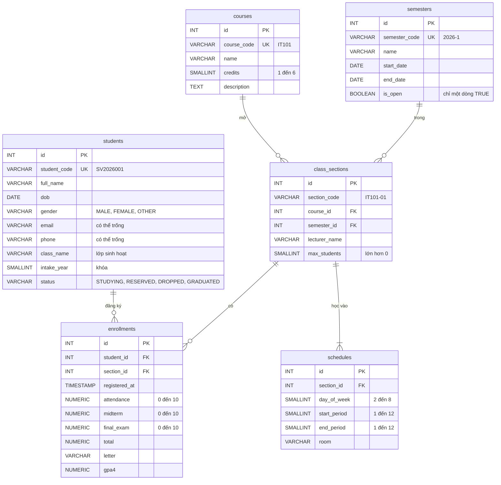

# Thiết kế cơ sở dữ liệu

> Issue: [#2](https://github.com/thang30102002/quan-ly-sinh-vien/issues/2) · Script: [`database/schema.sql`](../database/schema.sql), [`database/seed.sql`](../database/seed.sql) · Quy tắc nghiệp vụ: [`yeu-cau.md`](yeu-cau.md)

Database `qlsv` trên PostgreSQL 16, bộ mã `UTF8`, chạy bằng Docker (xem [`docker.md`](docker.md)). Khóa chính `id` là cột `GENERATED BY DEFAULT AS IDENTITY`.

## 1. Sơ đồ ERD



Ảnh chụp từ **ERD Tool** của pgAdmin (chuột phải database `qlsv` → *ERD For Database*): `docs/erd.png` (sub-issue [#26](https://github.com/thang30102002/quan-ly-sinh-vien/issues/26)).

## 2. Các bảng

| Bảng | Ý nghĩa | Ghi chú |
|---|---|---|
| `students` | Sinh viên | `status` lưu mã tiếng Anh, giao diện hiển thị *Đang học / Bảo lưu / Thôi học / Tốt nghiệp* (BR-20) |
| `courses` | Học phần | |
| `semesters` | Học kỳ | `is_open = TRUE` là học kỳ đang mở đăng ký |
| `class_sections` | Lớp học phần: một học phần mở trong một học kỳ | Một học phần có thể mở nhiều lớp trong cùng học kỳ |
| `schedules` | Buổi học lặp lại hằng tuần của lớp học phần | `day_of_week`: 2 = Thứ 2 … 7 = Thứ 7, 8 = Chủ nhật. Tiết 1–6 sáng, 7–12 chiều |
| `enrollments` | Sinh viên đăng ký lớp học phần, kèm điểm | `total`, `letter`, `gpa4` do phần mềm tính rồi lưu lại |

## 3. Ràng buộc trong CSDL

| Ràng buộc | Bảng | Quy tắc |
|---|---|---|
| `UNIQUE student_code` + CHECK `^SV[0-9]{7}$`, 4 số sau `SV` = `intake_year` | students | BR-01 |
| CHECK `phone` gồm 10 chữ số, bắt đầu bằng `0` | students | BR-17 |
| CHECK `gender` ∈ `MALE/FEMALE/OTHER`, `status` ∈ `STUDYING/RESERVED/DROPPED/GRADUATED` | students | BR-20 |
| `UNIQUE course_code` + CHECK `^[A-Z]{2,4}[0-9]{3}$` | courses | BR-02 |
| CHECK `credits` 1–6 | courses | BR-18 |
| `UNIQUE semester_code` + CHECK `^[0-9]{4}-[123]$` | semesters | BR-03 |
| CHECK `end_date > start_date` | semesters | BR-19 |
| Partial unique index `uq_semesters_open` trên `is_open` `WHERE is_open` | semesters | BR-26 |
| `UNIQUE (semester_id, section_code)` + CHECK dạng `IT101-01` | class_sections | BR-24 |
| CHECK `max_students > 0` | class_sections | BR-25 |
| CHECK thứ 2–8, tiết 1–12, `start_period ≤ end_period` | schedules | BR-21 |
| `UNIQUE (student_id, section_id)` | enrollments | |
| CHECK từng điểm thành phần 0–10, `NUMERIC(3,1)` | enrollments | BR-08 |
| CHECK `total` chỉ có khi đủ 3 điểm và bằng `ROUND(CC×0.1 + GK×0.3 + CK×0.6, 1)` | enrollments | BR-09 |
| CHECK `letter`, `gpa4` khớp bảng quy đổi theo `total` | enrollments | BR-10 |

Mã được kiểm tra phân biệt hoa thường (toán tử `~` của PostgreSQL), nên phần mềm phải đổi mã sang chữ in hoa trước khi lưu.

`gender` và `status` dùng `VARCHAR` + CHECK thay vì kiểu ENUM của PostgreSQL, để DAO gán được bằng `setString` mà không phải ép kiểu.

`ROUND(numeric, 1)` của PostgreSQL làm tròn nửa lên (8.45 → 8.5), khớp `RoundingMode.HALF_UP` trong Java.

### Khóa ngoại

| Khóa ngoại | Khi xóa bản ghi cha | Lý do |
|---|---|---|
| `class_sections.course_id → courses` | RESTRICT | BR-16: không xóa học phần đã mở lớp |
| `class_sections.semester_id → semesters` | RESTRICT | BR-16 |
| `schedules.section_id → class_sections` | CASCADE | Xóa lớp thì xóa luôn buổi học |
| `enrollments.section_id → class_sections` | RESTRICT | BR-16: không xóa lớp đã có sinh viên đăng ký |
| `enrollments.student_id → students` | CASCADE | BR-14: xóa sinh viên (chưa có điểm) thì xóa luôn đăng ký |

## 4. Quy tắc kiểm tra ở tầng Service

Các quy tắc sau không viết được bằng ràng buộc CSDL, phải kiểm tra trong code trước khi ghi:

| Quy tắc | Issue |
|---|---|
| BR-04 tối đa 12 tín chỉ/học kỳ · BR-05 không trùng môn trong học kỳ · BR-07 chỉ SV *Đang học* được đăng ký · BR-22 không trùng lịch · BR-25 lớp chưa đủ sĩ số · BR-26 học kỳ đang mở | #11 |
| BR-14 không xóa SV đã có điểm · BR-15 không hủy đăng ký đã có điểm | #6, #11 |
| BR-16 thông báo lỗi tiếng Việt khi xóa bị RESTRICT chặn | #9 |
| BR-17 định dạng email, đủ 16 tuổi | #4 |
| BR-21 các buổi của cùng một lớp không trùng nhau · BR-23 sửa lịch không làm trùng lịch sinh viên · BR-24 tiền tố mã lớp trùng mã học phần | #9 |

Riêng BR-26 vẫn nên kiểm tra ở Service để báo lỗi tiếng Việt thay vì lỗi `duplicate key value violates unique constraint` của CSDL. Muốn đổi học kỳ mở thì đóng học kỳ cũ trước rồi mới mở học kỳ mới, trong cùng một transaction.

Khi làm [#18](https://github.com/thang30102002/quan-ly-sinh-vien/issues/18) sẽ thêm bảng `users` và cột `class_sections.lecturer_id` (FK tới `users`).

## 5. Dữ liệu mẫu

`seed.sql` có 20 sinh viên, 10 học phần, 2 học kỳ (`2025-2` đã đóng, có điểm; `2026-1` đang mở, chưa có điểm), 15 lớp học phần (IT102 và IT201 mở 2 lớp ở HK `2026-1`) và 17 buổi học. Danh sách các ca dùng để thử từng quy tắc nằm ở đầu file `seed.sql`.

## 6. Cách tạo lại database

Docker tự chạy `schema.sql` rồi `seed.sql` khi tạo volume lần đầu. Sau khi sửa script, tạo lại từ đầu:

```bash
docker compose down -v && docker compose up -d
```

Hoặc chạy lại hai script mà không xóa volume (`schema.sql` xóa các bảng cũ rồi tạo lại):

```bash
docker compose exec -T db psql -U qlsv -d qlsv -v ON_ERROR_STOP=1 < database/schema.sql
docker compose exec -T db psql -U qlsv -d qlsv -v ON_ERROR_STOP=1 < database/seed.sql
```

Không sửa cấu trúc bảng bằng cách bấm chuột trong pgAdmin: sửa `schema.sql` rồi chạy lại.
