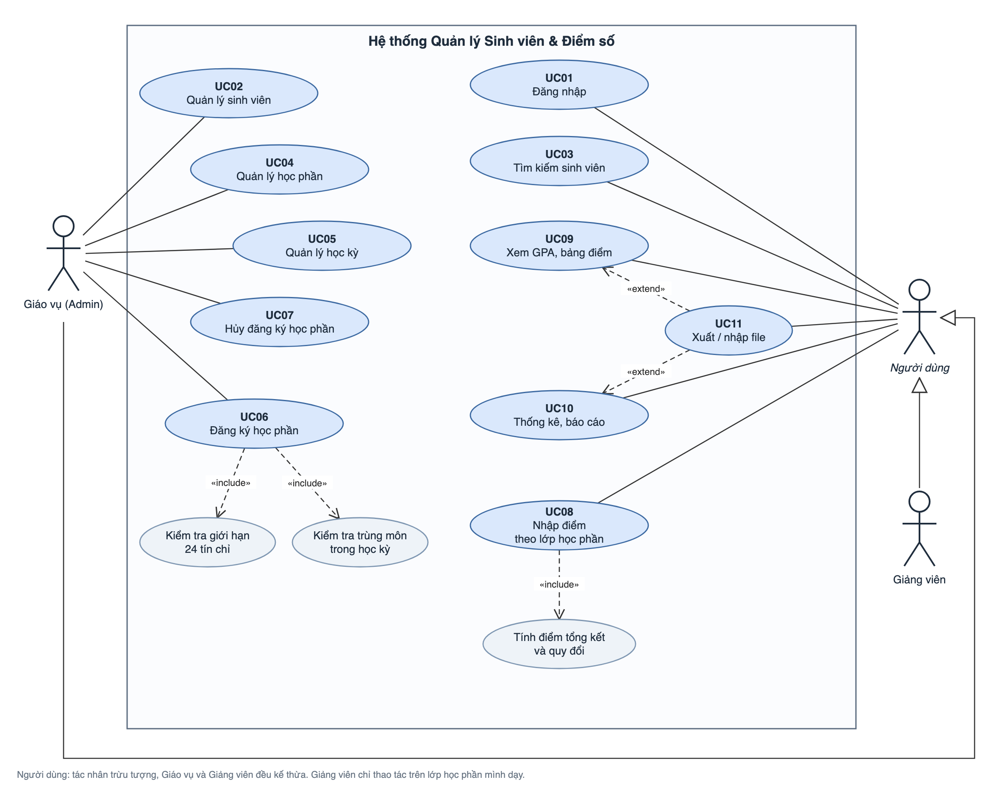

# Đặc tả yêu cầu: Phần mềm Quản lý Sinh viên & Điểm số

> Issue: [#1](https://github.com/thang30102002/quan-ly-sinh-vien/issues/1) · Phiên bản 1.0 · 19/10/2026
>
> Tài liệu này chốt phạm vi chức năng và quy tắc nghiệp vụ. Code, CSDL và test ở các issue sau phải theo đúng tài liệu này. Muốn thay đổi quy tắc thì sửa file này trước, qua PR có cả nhóm duyệt.

## 1. Giới thiệu

Phần mềm desktop (Java Swing + MySQL) cho phòng đào tạo của khoa/trường. Phần mềm dùng để quản lý hồ sơ sinh viên, học phần, học kỳ, đăng ký học phần, nhập điểm, tính GPA và lập báo cáo.

Ngoài phạm vi: thu học phí, xếp thời khóa biểu/phòng học, cổng thông tin cho sinh viên tự đăng nhập, ứng dụng web/mobile.

## 2. Người dùng

| Vai trò | Mô tả | Quyền chính |
|---|---|---|
| **Giáo vụ (Admin)** | Cán bộ phòng đào tạo, quản trị toàn bộ dữ liệu | Toàn quyền: quản lý sinh viên, học phần, học kỳ, đăng ký học phần; nhập/sửa điểm mọi lớp; thống kê; xuất/nhập file |
| **Giảng viên** | Người dạy các lớp học phần | Xem danh sách sinh viên của lớp mình dạy; nhập/sửa điểm lớp mình dạy; xem bảng điểm, thống kê của lớp mình |

Bảng phân quyền chi tiết:

| Chức năng | Giáo vụ | Giảng viên |
|---|:---:|:---:|
| Đăng nhập / đăng xuất | ✔ | ✔ |
| Thêm, sửa, xóa sinh viên | ✔ | |
| Tìm kiếm, xem sinh viên | ✔ | ✔ (lớp mình dạy) |
| Quản lý học phần, học kỳ | ✔ | |
| Đăng ký / hủy học phần cho sinh viên | ✔ | |
| Nhập, sửa điểm | ✔ | ✔ (lớp mình dạy) |
| Xem GPA, bảng điểm cá nhân | ✔ | ✔ (lớp mình dạy) |
| Thống kê, báo cáo | ✔ | ✔ (lớp mình dạy) |
| Xuất / nhập file | ✔ | Chỉ xuất bảng điểm lớp mình |

> Phần đăng nhập và phân quyền là tùy chọn ([#18](https://github.com/thang30102002/quan-ly-sinh-vien/issues/18)). Nếu không kịp làm, phần mềm chạy ở chế độ một người dùng với quyền Giáo vụ.

## 3. Phạm vi chức năng

### 3.1. Quản lý sinh viên
- Thêm sinh viên: mã SV, họ tên, ngày sinh, giới tính, email, số điện thoại, lớp sinh hoạt, khóa (năm nhập học), trạng thái.
- Sửa thông tin sinh viên. **Không được sửa mã SV.**
- Xóa sinh viên (có hỏi xác nhận, xem BR-14).
- Tìm kiếm theo mã SV, họ tên (không phân biệt hoa thường, khớp một phần), lớp, khóa, trạng thái. Có sắp xếp và phân trang/cuộn bảng.

### 3.2. Quản lý học phần và học kỳ
- Học phần: thêm, sửa, xóa, tìm kiếm. Thông tin gồm mã học phần, tên, số tín chỉ, mô tả.
- Học kỳ: thêm, sửa, xóa. Thông tin gồm mã học kỳ, tên, ngày bắt đầu, ngày kết thúc.
- Lớp học phần: mở một học phần trong một học kỳ và gán giảng viên phụ trách.

### 3.3. Đăng ký / hủy học phần
- Giáo vụ chọn sinh viên và học kỳ, rồi chọn các học phần được mở trong học kỳ đó để đăng ký.
- Hiển thị tổng số tín chỉ đã đăng ký trong học kỳ và số tín chỉ còn được đăng ký.
- Hủy đăng ký (xem BR-15).

### 3.4. Nhập điểm và tính GPA
- Nhập điểm theo lớp học phần: bảng gồm các sinh viên của lớp, mỗi dòng có 3 cột điểm chuyên cần, giữa kỳ, cuối kỳ.
- Phần mềm tự tính điểm tổng kết, điểm chữ, điểm hệ 4 và kết quả đạt/không đạt.
- Tính GPA học kỳ, GPA tích lũy, số tín chỉ tích lũy và xếp loại học lực.
- Xem bảng điểm cá nhân của sinh viên, nhóm theo từng học kỳ.

### 3.5. Thống kê, báo cáo, xuất file
- Thống kê theo lớp học phần: sĩ số, điểm trung bình, tỉ lệ đạt/trượt, phân bố điểm chữ.
- Thống kê theo học kỳ: số sinh viên theo xếp loại học lực, danh sách sinh viên có GPA cao nhất / bị cảnh báo (GPA học kỳ < 1.0).
- Xuất bảng điểm cá nhân, bảng điểm lớp học phần và danh sách sinh viên ra file CSV/Excel.
- Nhập danh sách sinh viên từ file CSV. Dòng nào không hợp lệ thì báo lỗi kèm số dòng, các dòng hợp lệ vẫn được nhập.

## 4. Quy tắc nghiệp vụ

Mỗi quy tắc có mã `BR-xx` để code, thông báo lỗi và test case tham chiếu.

### 4.1. Định danh

| Mã | Quy tắc |
|---|---|
| **BR-01** | Mã sinh viên là duy nhất, không sửa sau khi tạo. Định dạng: `SV` + 4 số năm nhập học + 3 số thứ tự, ví dụ `SV2026001`. Regex: `^SV\d{7}$`. |
| **BR-02** | Mã học phần là duy nhất. Định dạng: 2–4 chữ cái in hoa + 3 chữ số, ví dụ `IT101`, `MATH201`. Regex: `^[A-Z]{2,4}\d{3}$`. |
| **BR-03** | Mã học kỳ là duy nhất. Định dạng: `<năm bắt đầu năm học>-<số thứ tự>`, trong đó số thứ tự 1 là HK1, 2 là HK2, 3 là học kỳ hè. Ví dụ `2026-1` là HK1 năm học 2026–2027. Regex: `^\d{4}-[123]$`. |

Phần mềm tự chuyển mã sang chữ in hoa và bỏ khoảng trắng hai đầu trước khi kiểm tra định dạng.

### 4.2. Đăng ký học phần

| Mã | Quy tắc |
|---|---|
| **BR-04** | Tổng số tín chỉ một sinh viên đăng ký trong một học kỳ **không vượt quá 24**. Đăng ký đúng 24 tín chỉ là hợp lệ; nếu học phần mới làm tổng vượt 24 thì từ chối. |
| **BR-05** | Một sinh viên **không được đăng ký trùng một học phần trong cùng học kỳ**. |
| **BR-06** | Được đăng ký lại một học phần ở học kỳ khác (học lại khi trượt, học cải thiện khi đã đạt). |
| **BR-07** | Chỉ sinh viên có trạng thái *Đang học* mới được đăng ký học phần. |

### 4.3. Điểm

| Mã | Quy tắc |
|---|---|
| **BR-08** | Mỗi điểm thành phần (chuyên cần, giữa kỳ, cuối kỳ) là số thực trong khoảng **0 đến 10**, tối đa 1 chữ số thập phân. Có thể để trống khi chưa có điểm; khi đó chưa tính điểm tổng kết. |
| **BR-09** | Điểm tổng kết = Chuyên cần × **10%** + Giữa kỳ × **30%** + Cuối kỳ × **60%**, làm tròn **1 chữ số** thập phân (làm tròn nửa lên, ví dụ 6.45 thành 6.5). Phải nhập đủ 3 điểm thành phần mới tính. |
| **BR-10** | Quy đổi điểm chữ và hệ 4 dùng điểm tổng kết **sau khi đã làm tròn**, theo bảng ở mục 5.2. |
| **BR-11** | Học phần đạt khi điểm tổng kết ≥ 4.0 (điểm D trở lên). Điểm < 4.0 (điểm F) là **trượt**: không cộng vào số tín chỉ tích lũy và phải học lại. |
| **BR-12** | **Học lại một môn thì lấy lần điểm cao nhất**: GPA tích lũy và số tín chỉ tích lũy chỉ tính một lần cho mỗi học phần, dùng lần học có điểm tổng kết cao nhất. GPA học kỳ vẫn tính mọi học phần có điểm trong học kỳ đó. |
| **BR-13** | GPA = Σ(điểm hệ 4 × số tín chỉ) / Σ số tín chỉ, làm tròn **2 chữ số** thập phân. Học phần điểm F vẫn được tính vào GPA với điểm hệ 4 bằng 0. Học phần chưa có điểm tổng kết thì không tính. Nếu chưa có học phần nào có điểm thì GPA để trống, không hiển thị 0. |

### 4.4. Ràng buộc xóa / hủy

| Mã | Quy tắc |
|---|---|
| **BR-14** | **Không xóa sinh viên đã có điểm.** Nếu sinh viên đã có ít nhất một điểm thành phần thì chỉ được chuyển trạng thái sang *Thôi học*. Sinh viên chưa có điểm thì được xóa; khi xóa thì xóa luôn các đăng ký của sinh viên đó. |
| **BR-15** | **Không hủy đăng ký học phần khi đã có điểm.** Nếu đăng ký đã có ít nhất một điểm thành phần thì không được hủy. |
| **BR-16** | Không xóa học phần hoặc học kỳ đã có sinh viên đăng ký. |

### 4.5. Ràng buộc dữ liệu khác

| Mã | Quy tắc |
|---|---|
| **BR-17** | Họ tên: bắt buộc, tối đa 100 ký tự. Email (nếu nhập): đúng định dạng email. Số điện thoại (nếu nhập): 10 chữ số, bắt đầu bằng `0`. Ngày sinh: sinh viên phải đủ 16 tuổi trở lên. |
| **BR-18** | Số tín chỉ của học phần là số nguyên từ 1 đến 10. |
| **BR-19** | Ngày kết thúc học kỳ phải sau ngày bắt đầu. |
| **BR-20** | Trạng thái sinh viên là một trong các giá trị: *Đang học*, *Bảo lưu*, *Thôi học*, *Tốt nghiệp*. |

### 4.6. Xử lý lỗi
- Dữ liệu nhập sai định dạng hoặc thiếu (BR-01–03, BR-08, BR-17–20): ném `ValidationException`.
- Vi phạm nghiệp vụ (trùng mã, vượt 24 tín chỉ, đăng ký trùng môn, xóa hoặc hủy khi đã có điểm…): ném `BusinessException`.
- Thông báo lỗi hiển thị bằng tiếng Việt, nêu rõ trường hoặc quy tắc bị vi phạm. Ví dụ: *"Vượt quá 24 tín chỉ trong học kỳ 2026-1 (hiện có 22, thêm 3)"*.

## 5. Quy tắc tính điểm

### 5.1. Trọng số

| Thành phần | Trọng số |
|---|---|
| Chuyên cần (CC) | 10% |
| Giữa kỳ (GK) | 30% |
| Cuối kỳ (CK) | 60% |

Ví dụ: CC = 9, GK = 7, CK = 6.5. Điểm tổng kết = 0.9 + 2.1 + 3.9 = **6.9**, tức điểm C+ và 2.5 điểm hệ 4.

### 5.2. Bảng quy đổi

| Điểm tổng kết (thang 10) | Điểm chữ | Thang 4 | Kết quả |
|---|:---:|:---:|---|
| 8.5 – 10 | A | 4.0 | Đạt |
| 8.0 – 8.4 | B+ | 3.5 | Đạt |
| 7.0 – 7.9 | B | 3.0 | Đạt |
| 6.5 – 6.9 | C+ | 2.5 | Đạt |
| 5.5 – 6.4 | C | 2.0 | Đạt |
| 5.0 – 5.4 | D+ | 1.5 | Đạt |
| 4.0 – 4.9 | D | 1.0 | Đạt |
| < 4.0 | F | 0 | Trượt |

### 5.3. Xếp loại học lực (theo GPA hệ 4)

| GPA | Xếp loại |
|---|---|
| 3.60 – 4.00 | Xuất sắc |
| 3.20 – 3.59 | Giỏi |
| 2.50 – 3.19 | Khá |
| 2.00 – 2.49 | Trung bình |
| < 2.00 | Yếu |

### 5.4. Ca biên cần kiểm thử
- Điểm tổng kết 3.95 làm tròn thành 4.0, nên là điểm D, đạt.
- Điểm tổng kết 8.45 làm tròn thành 8.5, nên là điểm A.
- Đăng ký đúng 24 tín chỉ thì hợp lệ; thêm 1 tín chỉ nữa thì bị từ chối.
- Điểm thành phần −0.1 hoặc 10.1 thì bị từ chối; điểm 0 và 10 hợp lệ.
- Học một môn 2 lần, lần 1 được 3.0 (F), lần 2 được 6.0 (C): GPA tích lũy chỉ tính lần 2.

## 6. Danh sách use case

Sơ đồ: [`use-case.png`](use-case.png) (file gốc để chỉnh sửa: [`use-case.drawio`](use-case.drawio)).

Trên sơ đồ, *Người dùng* là tác nhân trừu tượng. Giáo vụ và Giảng viên đều kế thừa từ Người dùng nên dùng được các use case nối với Người dùng. Giảng viên chỉ thao tác trên lớp học phần mình dạy.

| Mã | Use case | Tác nhân | Issue |
|---|---|---|---|
| UC01 | Đăng nhập | Giáo vụ, Giảng viên | #18 |
| UC02 | Quản lý sinh viên (thêm, sửa, xóa) | Giáo vụ | #5, #6, #8 |
| UC03 | Tìm kiếm sinh viên | Giáo vụ, Giảng viên | #8 |
| UC04 | Quản lý học phần | Giáo vụ | #9 |
| UC05 | Quản lý học kỳ | Giáo vụ | #9 |
| UC06 | Đăng ký học phần | Giáo vụ | #11, #12 |
| UC07 | Hủy đăng ký học phần | Giáo vụ | #11, #12 |
| UC08 | Nhập điểm theo lớp học phần | Giáo vụ, Giảng viên | #14 |
| UC09 | Xem GPA và bảng điểm cá nhân | Giáo vụ, Giảng viên | #13, #15 |
| UC10 | Thống kê, báo cáo | Giáo vụ, Giảng viên | #16 |
| UC11 | Xuất / nhập file | Giáo vụ, Giảng viên | #17 |

Quan hệ giữa các use case:
- UC06 *include* "Kiểm tra giới hạn 24 tín chỉ" và "Kiểm tra trùng môn".
- UC08 *include* "Tính điểm tổng kết và quy đổi".
- UC11 *extend* UC09 (xuất bảng điểm cá nhân) và UC10 (xuất báo cáo).

## 7. Yêu cầu phi chức năng
- Chạy trên Windows/macOS với JDK 17 và MySQL/MariaDB (XAMPP).
- Giao diện tiếng Việt, hiển thị đúng Unicode. CSDL dùng `utf8mb4`.
- Mọi truy vấn dùng `PreparedStatement` để tránh SQL injection.
- Tìm kiếm trên 1.000 sinh viên trả kết quả trong dưới 1 giây.
- Phần tính điểm/GPA (`GpaCalculator`) và kiểm tra dữ liệu (`Validator`) có unit test JUnit 5, phủ các ca biên ở mục 5.4.
